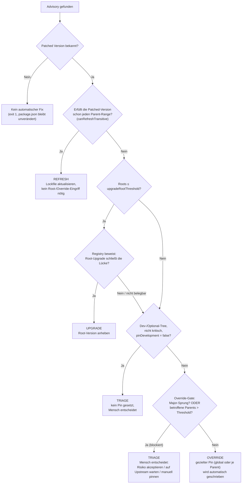

# Decision Layer

Dieses Dokument beschreibt die tatsächlich implementierte Entscheidungslogik in
`src/decision/engine.ts` (`decide()` + `resolveUpgradeDecision()`). Es ersetzt die
ursprüngliche Skizze, die noch nicht mit dem Code abgeglichen war.

## Leitidee

Overrides sollen **punktuell** bleiben, nicht die Standardantwort sein. Zwei Dinge
entscheiden, ob ein Override automatisch geschrieben wird, oder ob ein Mensch
gefragt wird ("Triage"):

1. **Bruchrisiko** – springt der Pin über eine Major-Version? (gleiche Definition
   wie überall sonst im Code, z. B. `breakingPinNote`/`breakingUpgradeNote`.)
2. **Streuung** – wie viele Parents (Scopes) bräuchten einen eigenen Pin?
   Wiederverwendet wird dafür der bereits vorhandene `upgradeRootThreshold`.

Ein Override, der *innerhalb derselben Major-Version* bleibt und nur wenige
Parents betrifft, ist der Normalfall, für den `overrides`/`resolutions`
überhaupt existieren (z. B. ein Patch-Release erzwingen, obwohl ein Parent
exakt eine ältere Version deklariert). Den blockieren wir nicht – das wäre
genau die Überautomatisierung in die andere Richtung. Blockiert wird nur, was
wirklich riskant (Major-Sprung) oder wirklich unübersichtlich (zu viele
Parents) wäre.

## Flowchart

## Die Stationen im Detail

1. **Kein Patch vorhanden** → harter Stopp, `package.json` bleibt unangetastet.
   Das ist kein "Override ohne Version", sondern schlicht: nichts Sicheres zum
   Anpinnen vorhanden.

2. **Refresh** (`canRefreshTransitive`) — wenn die gepatchte Version bereits
   von *jedem* direkten Parent akzeptiert wird, reicht ein Lockfile-Refresh.
   Kein Root-Upgrade, kein Override nötig. Das war schon vorher gut und bleibt
   unverändert die erste Wahl.

3. **Upgrade-Versuch** nur, wenn `rootCount ≤ upgradeRootThreshold`. Wird der
   Versuch von der Registry nicht belegt (keine neue Root-Version schließt die
   Lücke), fällt die Entscheidung weiter durch — sie wird **nicht** automatisch
   zum Override, sondern durchläuft dieselbe Triage-/Override-Prüfung wie der
   direkte Pfad.

4. **Dev-/Optional-Zweig, nicht kritisch** (`pinDevelopment: false`) → Triage.
   Unverändert aus der vorherigen Logik übernommen (vormals `"wait"`, jetzt
   unter dem einheitlichen Namen `"triage"`).

5. **Override-Gate** — das eigentliche Herzstück der Änderung. Ein Override
   wird automatisch geschrieben, *außer*:
   - der Pin würde eine installierte Kopie über eine Major-Grenze schieben
     (z. B. `uuid@9.0.0 → 11.1.1`), **oder**
   - die Anzahl der benötigten Scopes (globaler Pin oder Pins je Parent)
     überschreitet `upgradeRootThreshold` (z. B. 5 Parents brauchen je einen
     eigenen Pin für `minimatch`, Threshold ist 3).

   In beiden Fällen geht die Entscheidung an **Triage** statt automatisch
   geschrieben zu werden. Die Begründung wird dem Menschen mitgegeben
   (Major-Sprung-Hinweis bzw. Parent-Range-Konflikt, oder Anzahl der
   betroffenen Parents vs. Threshold).

6. **Override** — alles, was durch das Gate kommt: ein Patch-/Minor-Bump
   innerhalb derselben Major-Version, begrenzt auf wenige Parents. Das ist der
   bewusst klein gehaltene Rest, der automatisch passieren darf.

## Zwei Beispiele aus der Testsuite

- **`qs` unter `express`/`body-parser`** (`6.5.0 → 6.11.2`): beide Parents
  deklarieren `qs` exakt als `6.5.0`, die neue Version würde diesen Range
  technisch verletzen. Trotzdem **kein** Major-Sprung und nur 1–2 Parents
  betroffen → automatischer Override. Das ist der Standardfall, für den
  `overrides` gemacht wurde.
- **`marked` unter `old-tool`** (`1.0.0 → 4.0.0`): Major-Sprung → Triage,
  auch wenn nur ein einziger Parent betroffen ist. Hier soll ein Mensch
  bewusst entscheiden.

## Was bewusst nicht übernommen wurde

Die ursprüngliche Skizze wollte *jede* Range-Verletzung eines Parents (nicht
nur Major-Sprünge) als "breaking" werten und blockieren. Das hätte den
Normalfall von `overrides` (Patch über eine starr gepinnte Parent-Range hinweg
erzwingen) mitblockiert und `TRIAGE` zur neuen Dauerlast gemacht – genau das
Sprawl-Problem nur an anderer Stelle. Stattdessen bleibt "breaking" an der
bestehenden Definition im Code (Major-Versionswechsel) ausgerichtet; die
Range-Verletzung eines Parents bleibt ein informativer Hinweistext im
Override-Report, blockiert aber nicht für sich allein.

## Priorität, wie implementiert

1. Refresh (Lockfile-Update, keine Code-/Range-Änderung nötig)
2. Root-Upgrade (nur bis `upgradeRootThreshold` Roots, und nur wenn belegbar)
3. Automatischer, kompatibler Override (Major-Grenze intakt, Parents im Rahmen des Thresholds)
4. Triage (Major-Sprung, zu viele Parents, nicht-kritischer Dev-/Optional-Zweig, oder kein Patch belegbar) — Mensch entscheidet: Risiko akzeptieren, auf Upstream warten, oder manuell pinnen.
